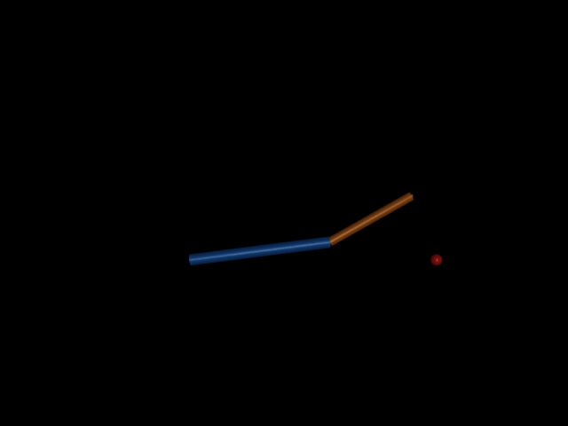
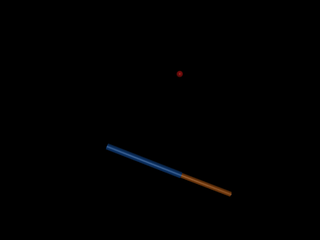

# 项目 02 图形化实操课：先看运动，再读代码

本课使用同一台二连杆机械臂完成三件事：在 MuJoCo 看真实物理仿真、在数据文件核对运动、在 RViz 看 ROS 2 发布的模型和坐标系。建议依照本页顺序操作，每一步都有可见结果。

## 一、先认识四个对象

| 名称 | 在本项目中的工作 | 你会看到什么 |
| --- | --- | --- |
| Ubuntu / WSL | 在 Windows 电脑中运行 ROS 2 Jazzy 的 Linux 环境 | 一个名为 Ubuntu-24.04 的环境；项目代码在 `~/embodied-robotics-learning-lab` |
| URDF | 描述机械臂的刚体、关节、外观、惯量和连接位置 | `model/arm2d.urdf` 中的 `base_link → link1 → link2 → tool_link` |
| MuJoCo | 按惯量、阻尼和电机力矩推进物理仿真 | 蓝色第一连杆、橙色第二连杆向红色目标点运动 |
| ROS 2 与 RViz | ROS 2 传递关节状态与坐标变换；RViz 把这些消息画出来 | 机械臂模型、`TF` 坐标轴、`/joint_states` 等消息 |

这条链路对应代码：`arm2d.urdf` 给出模型；`scripts/run_mujoco.py` 用模型与控制器生成运动；`scripts/ros_sim_node.py` 把同类仿真状态发布到 ROS 2；RViz 订阅模型与坐标变换。

## 二、双击启动 MuJoCo，亲眼看一次可达目标

在 Windows 文件管理器打开本项目目录，双击 [`open_visual_demo.cmd`](open_visual_demo.cmd)。脚本会启动 MuJoCo 图形窗口，以 **0.15 倍展示速度**播放一次目标 `(0.55, 0.55) m` 的实验。仿真物理步长仍为 `0.002 s`，控制周期仍为 `0.02 s`；慢速设置只延长屏幕上的观看时间。成功后画面停留 15 秒，随后自动打开新生成的 `outputs/guided-demo/animation.gif`。

在窗口里按顺序观察：

1. 中间的蓝色连杆是 `link1`，长 `0.6 m`；橙色连杆是 `link2`，长 `0.4 m`。红色小球标记目标。
2. 右侧展开 **Joint**：`shoulder`、`elbow` 是两个关节角，单位为弧度。展开 **Control**：`shoulder_motor`、`elbow_motor` 是电机控制量，单位为牛·米。本轮先观察这些值随画面变化，保持滑块原值。
3. 用鼠标在黑色画面中拖动，可改变观察视角；滚轮可缩放。拖动相机只改变看图角度。机械臂的关节角和末端位置以日志为准。
4. 运动结束后打开 `outputs/guided-demo/summary.json`：`termination` 应为 `success`，`steps` 应为 `100`，末端误差约 `0.000927 m`。

已有可重复观看的[可达目标动画](outputs/local-validation-2026-10-12/reachable/animation.gif)：

## 三、把画面和代码、数字连起来

打开 [`model/arm2d.urdf`](model/arm2d.urdf)，找到 `joint name="elbow"`。其中 `<origin xyz="0.6 0 0"/>` 表示肘关节位于第一连杆起点沿自身 x 轴 `0.6 m` 处。再找 `tool_fixed` 的 `<origin xyz="0.4 0 0"/>`：末端位于第二连杆起点前方 `0.4 m`。两段完全伸直时，末端离底座最大距离为 `1.0 m`。

打开 [`scripts/run_mujoco.py`](scripts/run_mujoco.py)，把四处代码和画面对应起来：`build_sim_model()` 导入 URDF 并添加力矩电机；`data.ctrl[:]` 写入当前电机命令；`mujoco.mj_step()` 推进物理时间；`tip_from_mujoco()` 读取末端坐标。打开 `outputs/guided-demo/trajectory.csv`，一行代表一个控制步：`qpos` 是关节角，`qvel` 是角速度，`ctrl` 是电机力矩，`tool_x_m/tool_y_m` 是末端位置，`error_m` 是到目标的距离。

检查第 1 行和第 100 行：可达实验误差约从 `0.473 m` 降到 `0.000927 m`。GIF 是画面证据，CSV 是逐步数字证据，`summary.json` 是终态摘要。

## 四、看三个实验，再说出自己的预测

### 实验 A：可达目标

目标 `(0.55, 0.55) m`，seed 7。机械臂在 100 个控制步、`2.00 s` 仿真时间到达目标，终态误差约 `0.93 mm`。

### 实验 B：不可达目标

目标 `(1.05, 0) m`。观看[不可达目标动画](outputs/local-validation-2026-10-12/unreachable/animation.gif)：

观看前先预测：两段总长 `1.00 m`，目标离底座 `1.05 m`，最小可能误差为 `0.05 m`。本机记录在 600 步上限处停下，最终误差为 `0.050000 m`。`max_steps` 表示到达预设步数上限；这次实验同时验证几何边界。

### 实验 C：换初始姿态

目标仍为 `(0.55, 0.55) m`，seed 改为 11。观看[另一初姿动画](outputs/local-validation-2026-10-12/seed11/animation.gif)：

初始关节角改变，轨迹与所需步数也改变；本次在 152 步、`3.04 s` 仿真时间成功，终态误差约 `0.986 mm`。请暂停两段动画的第一帧，比较蓝色与橙色连杆的朝向。

## 五、在 RViz 里看 ROS 2 桥接

这一步先启动 ROS 2 桥接，再把注意力放在 RViz 窗口。项目 README 的“Ubuntu + ROS 2 Jazzy”段落提供启动命令。启动 `scripts/start_ros.py` 后，`/joint_states` 携带两个关节角；`robot_state_publisher` 根据同一份 URDF 发布 `/tf` 与 `/tf_static`。

打开 RViz 后亲手点四处：

1. 左侧 `Global Options → Fixed Frame` 设为 `base_link`；此时 `Global Status` 应显示 `Ok`。
2. 左下 `Add` 选择 `RobotModel`；展开该项，将 `Description Topic` 设为 `/robot_description`。屏幕中出现蓝、橙两段机械臂和绿色末端。
3. 再按 `Add` 选择 `TF`；关节附近出现红、绿、蓝的局部坐标轴。右侧 `Views → Current View → Distance` 设为 `2.5`，模型会放大到便于观察的大小。
4. 在另一终端调用重置服务 `ros2 service call /robot_lab/reset std_srvs/srv/Trigger '{}'`，目视机械臂重新运动。随后运行 `python scripts/verify_bridge.py`，核对 `status=success`、目标误差与 `tf_gap_m`。

本机现场演示中，RViz 显示了中途姿态和终态；独立脚本测得目标误差 `0.000927351103 m`，MuJoCo 末端与 TF 末端差 `1.11e-16 m`。RViz 展示 ROS 2 中的状态，MuJoCo 负责物理推进；这两个窗口展示同一机械臂链路的不同环节。

## 本课验收

关掉讲解后，独立完成三件事：在 MuJoCo 窗口指出两个关节、两个电机和目标；用动画预测不可达实验的最终误差，并用 `summary.json` 验证；在 RViz 中找到 `RobotModel`、`TF` 与 `base_link`，再调用一次重置。保留生成的 GIF、CSV、摘要和一次自己的观察记录，作为本项目的学习证据。
