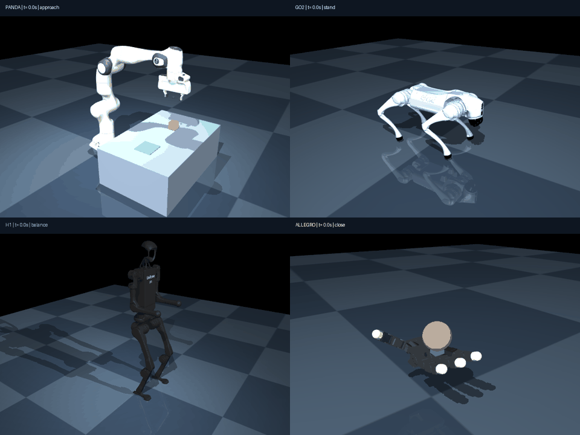

# 项目 03：四类机器人进阶物理实验

当前学习阶段：**仿真与机器人软件**。按 Panda → Go2 → H1 → Allegro 的顺序练习，通过个人验收后进入模仿学习。



## 已运行的功能与边界

| 平台 | 执行器 | 实验功能 | 本机基线结果 | 当前能力边界 |
|---|---:|---|---|---|
| Franka Panda | 7 臂关节 + 夹爪 | 6D 数值 IK、接触抓取、抬升、搬运、释放 | 抬升 19.2 cm；放置误差 3.8 mm | 固定桌面、单方块、给定位姿序列 |
| Unitree Go2 | 12 | 足端周期轨迹、腿部 IK、力矩 PD、对角步态 | 前进 1.17 m；最大倾斜 5.12°；足端离地 3.94 cm | 平地、固定参数、确定性周期步态 |
| Unitree H1 | 19 | 双足站立、质心反馈、下蹲、抬臂、恢复站姿 | 下蹲 8.73 cm；最大倾斜 5.57° | 双足支撑平衡与上肢协同；行走另设验收 |
| Allegro 右手 | 16 | 多指合拢、撤去支撑、腕部抬升、接触保持 | 球心最终高 35.8 cm；末段多指保持比例 100% | 掌面辅助包络抓持；腕部为规定运动夹具；手内重定向另设验收 |

这些结果来自 `outputs/baseline/*/summary.json` 与原始 CSV。20 项自动检查通过，包含四类基线、逐字节相同重复轨迹和四类失败对照。每类基线重复 2 次；这些重复检查衡量同机确定性，跨平台数值与扰动泛化需要追加评测。

## 本机图形入口

双击 `open_lab.cmd`：四个标签对应四类机器人，左侧循环回放本机实验，右侧可改参数、启动实时 3D 物理实验和失败对照。点击“运行物理实验”后，MuJoCo 窗口运行完整任务，结束后保留 15 秒，再把本次回放与指标载入面板。

详细操作、知识卡片、代码阅读和学生验收见 [实操课.md](实操课.md)。

## 新电脑复现（Windows + Python 3.12 + Git）

在本目录运行：

```powershell
.\setup.ps1
.\.venv\Scripts\python.exe verify.py
.\.venv\Scripts\python.exe render_all.py
.\open_lab.cmd
```

`setup.ps1` 建立独立环境并下载四类公开模型。模型缓存位置为用户目录下的 `.cache/robot-learning/menagerie`；已有缓存修改会使安装脚本暂停，便于保留个人模型编辑。当前本机入口兼容复用项目 02 已验证环境。

单项实验示例：

```powershell
..\project-02-urdf-mujoco-ros2\.venv\Scripts\python.exe lab.py panda --viewer --render --output outputs/my-panda
..\project-02-urdf-mujoco-ros2\.venv\Scripts\python.exe lab.py go2 --output outputs/my-go2 --options '{"kp":100,"amp":0.055}'
```

输出包含 `trajectory.csv`（50 Hz，关节位置/速度、执行器命令、目标、接触、足端离地、阶段）、`summary.json`（自动判据）、`config.json`（版本、种子、步频、实际配置、源码哈希、模型哈希）、`demo.gif` 和 `preview.png`。物理步长 2 ms，控制周期 10 ms；数值 IK 只修改规划副本，执行状态通过 MuJoCo 动力学步进更新。

## 来源与许可证

模型来自 [Google DeepMind MuJoCo Menagerie](https://github.com/google-deepmind/mujoco_menagerie)，固定提交 `0059d4335f8156206f63a35662313385f7ad6d74`。模型在缓存中保留原目录 README 与 LICENSE，本项目 `licenses/` 同时保留四份上游许可。Panda 使用 Apache-2.0，Go2/H1 使用 BSD-3-Clause，Allegro 使用 BSD-2-Clause；本项目原创代码使用本目录 MIT LICENSE。公开仓库发布原创控制代码、配置和渲染输出，模型资源通过固定提交下载。

场景改动：增加地面与灯光；Panda 增加桌面、方块、末端 site、指垫摩擦；Allegro 增加腕部 mocap 夹具、可撤去支撑台、球、接触摩擦并将位置伺服 kp 设为 3。Go2/H1 浮动基座由动力学自由演化。模型标识支持本项目软件实验，实机参数辨识与安全评测保留独立任务。

## 与 Ubuntu / ROS 2 连接

当前图形实验在 Windows MuJoCo 运行。模型使用 Menagerie 原生 MJCF；项目 02 的 URDF → MuJoCo → ROS 2 链路继续保留。URDF 侧重机器人连杆/关节描述，MJCF 同时表达本实验的动力学场景、执行器与接触设置。

`ros_replay.py` 将四类 CSV 记录发布成真实 ROS 2 `JointState` 与 `PointStamped` topic。已在本机 WSL Ubuntu 24.04 + ROS 2 Jazzy 验证：四平台各 50 条关节消息、50 条位置消息均被订阅端接收，关节数分别为 9、12、19、16。报告见 `outputs/ros-validation.json`。这一接口是记录状态回放与消息接收检查；实时命令桥接、URDF/TF 树和四平台 RViz 模型显示属于追加工程项。

在 Ubuntu 中，进入本项目挂载目录后运行：

```bash
source /opt/ros/jazzy/setup.bash
python3 ros_replay.py outputs/baseline --all --validate --report outputs/ros-validation.json
```

单个平台可使用 `python3 ros_replay.py outputs/baseline/go2`。topic 位于 `/robotlab/<平台>/joint_states` 和 `/robotlab/<平台>/tracked_point`；机械臂/手的 tracked_point 是物体位置，狗/人形的是基座位置。Panda 第二指按模型的耦合约束由第一指状态展开。

## 验收状态

工程基线：已通过。图形回放与实时窗口：本机验证。个人学习闸门：按实操课提交四份修改实验与解释后核验。当前继续推进本阶段，下一部分保持为模仿学习。
