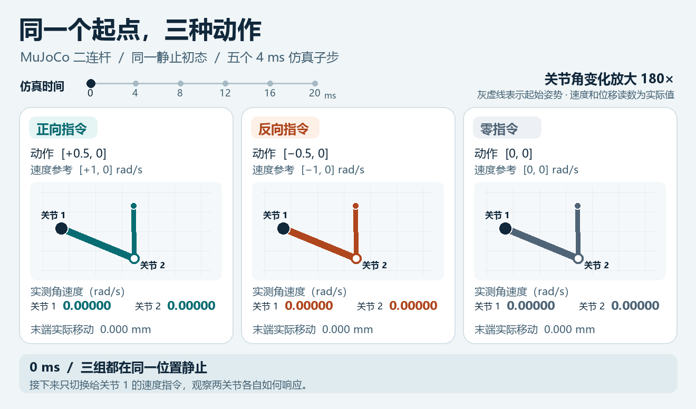

# 世界模型与 WAM 第一周

目标是在二连杆 MuJoCo 环境中完成一条可复现的工作流，从数据对齐、训练和推理到闭环验收。每天按表推进，共约 9 小时。首周用低维状态与小型 MLP 在 CPU 上验证机制。

## 每天的任务

| 时间 | 学什么 | 动手与当天验收 |
| --- | --- | --- |
| Day 1 · 75 分钟 | 前向动力学、BC、WAM 的输入输出 | 读 DreamZero 方法图与 Fast-WAM 的消融。画三条数据流，注明训练目标、推理可用字段、动作块长度和实际执行步数。先预测正、反、零三个动作的结果，再跑下方命令核对 20 ms 后的关节速度。 |
| Day 2 · 90 分钟 | 时序对齐、动作表示、按回合划分 | 自己实现采集和滑窗。保存一条可手查的 10 步轨迹，在同一重置状态分别施加正、反、零动作。用变化动作的片段做一格错位测试，验证正确对齐的片段可重放，故意错位的片段会触发检查。 |
| Day 3 · 90 分钟 | 单步预测与多步误差累积 | 实验 A 先用一个训练种子跑通。看一步和五步末端误差，再检查正反动作的预测差是否与仿真差方向一致。保存一个预测偏差最大的案例。 |
| Day 4 · 105 分钟 | 动作块、未来状态监督、滚动执行 | 实验 B 先在一个训练回合跑通拟合，然后做一个种子的配对闭环。检查真实未来只参与训练损失、推理每次收到当前新观测。 |
| Day 5 · 90 分钟 | 配对评测、域外测试和延迟 | 冻结方案后跑完 3 个种子。生成预测误差曲线、按种子分组的成功表和一组成败回放。标记动作首次分叉、限位干预或终止原因。 |
| Day 6 · 60 分钟 | 从仿真协议迁移到模型验收 | 用一页纸写案例级验收卡。获准使用的模型在原环境跑一条样本，同一检查点和配置复跑并对齐延迟口径。缺少模型访问时，用二连杆回放填表并记录模型侧待验证项。 |
| Day 7 · 45 分钟 | 独立复现和口述 | 用一条命令复跑小样例，展示自己写的对齐检查或动作块执行代码，讲清两个实验各检验了什么、最典型的失败在哪一步。整理一页结果和下一轮单因素改动。 |

Day 1 阅读范围为联合未来画面和动作的 [DreamZero](https://dreamzero0.github.io/) 及区分训练期视频监督与推理期视频生成的 [Fast-WAM](https://arxiv.org/abs/2603.16666v2)。[Kling 官方说明](https://ir.kuaishou.com/zh-hans/news-releases/news-release-details/kuaishouziyanshipinshengchengdamoxingkelingkaifangceshi) 用于了解视频生成接口。评估生成视频时看动作时序、物体连续性与接触后的变化。模型或下游模块能输出动作时，再用实际执行结果判断任务是否完成。

## Day 1 可执行入口

在仓库根目录打开 PowerShell。已有项目 02 虚拟环境且依赖可导入时，直接复用它。也可以使用项目 05 的固定依赖环境。

```powershell
& .\project-02-urdf-mujoco-ros2\.venv\Scripts\python.exe .\project-06-world-model-wam\day1_control_step.py
```

项目 02 环境缺失时，从根目录运行 `powershell -ExecutionPolicy Bypass -File .\project-05-reinforcement-safety\setup.ps1`，将上面的解释器路径换为项目 05 的 `.venv\Scripts\python.exe`。查看 `initial.observation` 和各组的 `final.observation`，它们都是 11 维。观测第 5、6 项乘 4 得到关节角速度，在 `final.dq_rad_s` 中核对。输入为两维归一化关节速度指令 `[-1,1]`，试验报告也打印护栏处理后的速度参考 `applied_velocity_ref_rad_s`。对照 [ArmPhysics 接口](../project-05-reinforcement-safety/physical_env.py) 和 [DLS 评测入口](../project-05-reinforcement-safety/continuous.py)。可复用 [项目 04 的 NumPy MLP 与 BC 实现](../project-04-imitation-learning/learning.py) 的训练结构。

### 三动作逐步慢放



动图显示 0–20 ms 的六个实测状态。彩色姿态的关节角变化放大 180 倍，灰虚线标出起始位置，速度和末端位移是仿真读数。先跟左列从速度指令看到实际转动，再看右列，最后对比三列中的第二关节速度。

在仓库根目录复现，Windows 默认使用微软雅黑。其他环境可用 `--font` 和 `--bold-font` 指定本地中文字体。

```powershell
& .\project-02-urdf-mujoco-ros2\.venv\Scripts\python.exe .\project-06-world-model-wam\render_day1_motion.py --output-dir .ci-output
```

## 冻结的数据和实验协议

- 用 `ArmPhysics` 默认物理配置。一个控制步 20 ms，内部 5 个仿真子步。成功为末端误差小于 45 mm 且关节速度向量范数小于 0.4 rad/s，连续 5 步。每回合至多 150 步，保留现有 guard 与越界判据。
- 建议重置种子按用途预先冻结。开发用 4000；同分布训练 4100–4139、验证 4200–4209、测试 4300–4319；域外测试 4400–4419，使用环境的 `ood` 负肘分支。训练种子用 0、1、2。正式测试前登记配置；实验 A 的随机动作流与实验 B 的 DLS 示范分别记录。
- 每行保存 `episode_id, reset_seed, split, t, q_t, dq_t, goal, raw_action, applied_velocity, q_next, dq_next, terminated, truncated, guard_intervention`。记录动作坐标、单位及采样频率。按重置种子分组后再切窗口，同一起点派生的所有动作分支进入同一集合；标准化统计仅从训练集估计，终止后的目标用掩码或丢弃跨终止窗口。测试集用于最终评估，超参和检查点用训练及验证集选择。

### 实验 A：模型是否看懂了动作的后果

用有变化的、限幅内的激励动作采集动力学样本。在部分重置上用正、反和零动作分支确认同一状态的不同演化。比较状态保持、仅用当前状态的 MLP、输入当前状态和当前动作的 MLP。两种 MLP 的层宽、训练样本、优化预算一致，可给状态组的动作槽填零。用相同留出初态和真实日志中的动作序列，分别测一步和递归五步的关节角 RMSE（rad）、角速度 RMSE（rad/s）及末端误差（mm）。递归五步只在起点读真实状态，每步把上一轮预测回填，并传入下一条记录动作。单独列出同态反向动作时的真实与预测状态差。预期动作条件模型在 ID 上降低五步末端误差，并预测出反向动作引起的角速度变化方向。OOD 结果单独报告。

### 实验 B：未来状态监督能否改善闭环

先用 DLS 采集示范。两组策略共享结构和输入 `(当前观测, 目标)`，预测接下来 5 个 DLS 动作。对照组令未来状态损失权重为 0，实验组加入未来 5 步关节状态损失。记录权重及各目标标准化方式，权重只从验证集选定。两组固定数据、初始化种子、训练更新次数、执行频率和动作限幅。部署时都只取预测动作块的第一条，执行后读取新观测再规划。这个低维实验检验训练期辅助监督，WAM 视频生成与推理期未来条件化属于进阶问题。

用相同 20 个同分布（ID）和 20 个域外（OOD）重置种子评测 DLS 和两组策略。离线报告归一化动作 MAE 和实验组未来状态误差。闭环报告成功数/总数、末端误差、时间和终止原因、限位干预率与越界数，以及同一台机器上热身后的策略前向延迟 P50/P95。配对表逐种子、逐域列出 BC 失败后实验组成功，以及 BC 成功后实验组失败的数量。延迟报告注明测量边界与硬件。重复使用相同评测回合的三个训练种子反映训练随机性，同时保留逐种子结果。首周优先关注 OOD 配对净胜数。相符的种子越多，越值得在新留出条件上进一步验证。

## 第一周验收

| 项目 | 通过条件 |
| --- | --- |
| 数据 | 自己写的检查确认三种同态起始动作可重放，故意错位样本被拒绝，训练/验证/测试的重置种子交集为空。能指出日志里的指令速度与施加速度。 |
| 实验 | A/B 按锁定协议运行，公开记录配置、依赖版本、代码提交、模型 XML 与数据哈希、种子、命令、原始逐回合指标和汇总。一条命令可重跑一个小样例。提供预测误差曲线及至少一段可见回放。 |
| 个人 | 交自己的一个代码 diff，先写下一个可检验预测，然后解释一条失败轨迹的第一处偏差、证据和下一次单因素改动。能口述开环预测好与闭环任务成功各自需要什么证据。 |
| 结论 | 学习通过依据是有效对照、可复现与个人解释。实验 A 的收益看配对预测误差和反向动作响应。实验 B 的收益看配对闭环净增成功数、越界与延迟的代价。零收益和负收益照实登记。三个种子构成首周 pilot，正式性能验收扩到至少五个种子和额外留出任务。 |

案例级验收卡字段为模型名称/版本/许可与运行环境、输入字段/单位/时间戳、输出语义和频率、固定样本 ID、判据、预测结果、执行结果、延迟口径、失败证据及待验证项。公开记录采用仓库仿真与公开资料。
